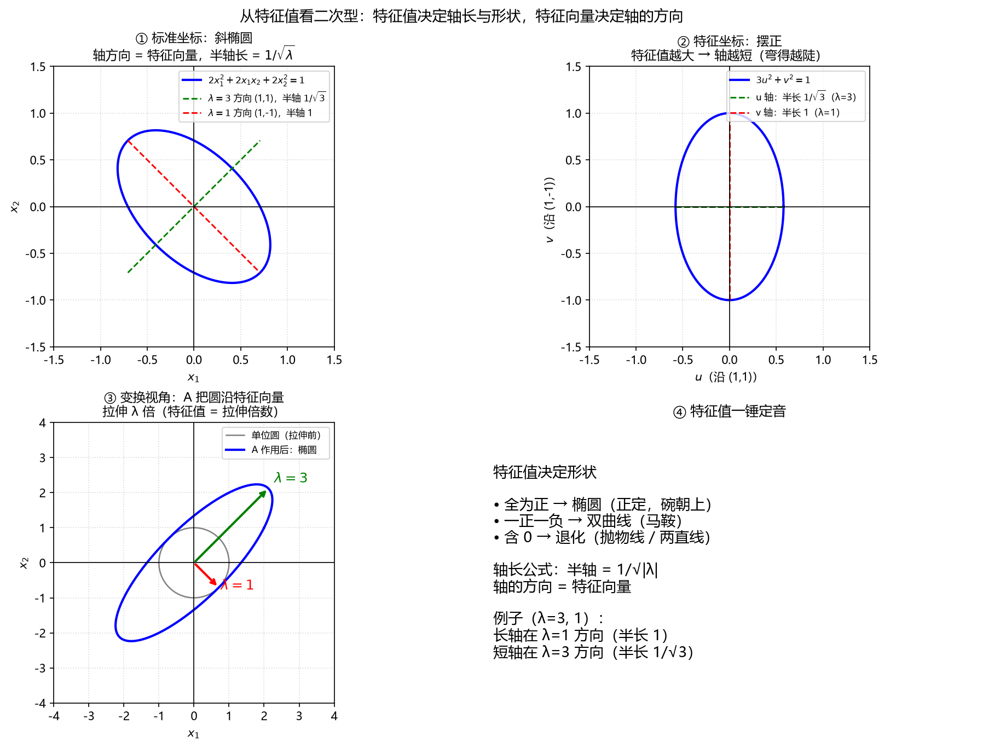

# 伴随矩阵

矩阵中所有的值都去求代数余子式，之后将矩阵转置就是伴随矩阵

## 二阶矩阵伴随矩阵

设矩阵：
$$A = \begin{pmatrix} a & b \\\\ c & d \end{pmatrix}$$

**求每个元素的余子式**

代数余子式 $A_{ij} = (-1)^{i+j} M_{ij}$，其中 $M_{ij}$ 是划掉第 $i$ 行第 $j$ 列后剩下的行列式。

- $A_{11}$：划掉第1行第1列，剩下 $d$，符号 $+$，所以 $A_{11} = d$
- $A_{12}$：划掉第1行第2列，剩下 $c$，符号 $-$，所以 $A_{12} = -c$
- $A_{21}$：划掉第2行第1列，剩下 $b$，符号 $-$，所以 $A_{21} = -b$
- $A_{22}$：划掉第2行第2列，剩下 $a$，符号 $+$，所以 $A_{22} = a$

#### 代数余子式

**代数余子式矩阵**

把代数余子式按原位置排成矩阵：
$$C = \begin{pmatrix} A_{11} & A_{12} \\\\ A_{21} & A_{22} \end{pmatrix}
= \begin{pmatrix} d & -c \\\\ -b & a \end{pmatrix}$$

**转置得到伴随矩阵**

$$\operatorname{adj}(A) = C^T = \begin{pmatrix} d & -b \\\\ -c & a \end{pmatrix}$$

### 具体例子

$$A = \begin{pmatrix} 1 & 2 \\\\ 3 & 4 \end{pmatrix}$$

- $A_{11} = 4$，$A_{12} = -3$，$A_{21} = -2$，$A_{22} = 1$
- 代数余子式矩阵：$\begin{pmatrix} 4 & -3 \\\\ -2 & 1 \end{pmatrix}$
- 伴随矩阵：$\operatorname{adj}(A) = \begin{pmatrix} 4 & -2 \\\\ -3 & 1 \end{pmatrix}$

验证 $A \cdot \operatorname{adj}(A) = \det(A) E$：

**伴随矩阵是逆矩阵去掉缩放**

$$\det(A) = 1 \cdot 4 - 2 \cdot 3 = -2$$

$$A \cdot \operatorname{adj}(A) =
\begin{pmatrix} 1 & 2 \\\\ 3 & 4 \end{pmatrix}
\begin{pmatrix} 4 & -2 \\\\ -3 & 1 \end{pmatrix}
=
\begin{pmatrix} -2 & 0 \\\\ 0 & -2 \end{pmatrix}
= -2E$$

**验证正确**

# 秩(rank)

秩：矩阵或向量组里“真正独立的方向数”。

满秩：矩阵没有冗余，能保留全部维度，可逆。

降秩：矩阵有冗余，会把空间压缩到更低维，不可逆。

# 线性相关与线性无关

线性无关 = 每个向量都带来新方向；线性相关 = 有的向量是别的向量的“拼凑品”

三维中，最多三个向量线性无关

# 矩阵转置

矩阵 A：

$$A=
\begin{pmatrix}
1&2&3\\\\
4&5&6\\\\
7&8&9
\end{pmatrix}$$

转置 A^T：

$$A^T=
\begin{pmatrix}
1&4&7\\\\
2&5&8\\\\
3&6&9
\end{pmatrix}$$

规则：原矩阵的第 i 行，变成转置后的第 i 列。

**转置的乘积规则**

$$(AB)^T=B^TA^T$$

例子：

$$A=\begin{pmatrix}1&2\\\\3&4\end{pmatrix},\qquad
B=\begin{pmatrix}5&6\\\\7&8\end{pmatrix}$$

先算 AB：

$$AB=
\begin{pmatrix}1&2\\\\3&4\end{pmatrix}
\begin{pmatrix}5&6\\\\7&8\end{pmatrix}
=
\begin{pmatrix}19&22\\\\43&50\end{pmatrix}$$

转置：

$$(AB)^T=
\begin{pmatrix}19&43\\\\22&50\end{pmatrix}$$

再算 B^T A^T：

$$B^TA^T=
\begin{pmatrix}5&7\\\\6&8\end{pmatrix}
\begin{pmatrix}1&3\\\\2&4\end{pmatrix}
=
\begin{pmatrix}19&43\\\\22&50\end{pmatrix}$$

结果相同，验证成立。


$(AB)^T=B^TA^T$相等的原因


矩阵乘法第 i 行第 j 列的元素是：

$$(AB)_{ij}=\sum_k a_{ik}b_{kj}$$

$$a(i,1)b(1,j)+a(i,2)b(2,j)+.....$$
转置后，第 i 行第 j 列变成原来的第 j 行第 i 列：

$$(AB)^T_{ij}=(AB)_{ji}=\sum_k a_{jk}b_{ki}$$

$$a(j,1)b(1,i)+a(j,2)b(2,i)+.....$$
而 B^T A^T 的第 i 行第 j 列是：

$$(B^TA^T)_{ij}=\sum_k B^T_{ik}A^T_{kj}
=\sum_k b_{ki}a_{jk}$$

$$b(1,i)a(j,1)+b(2,i)a(j,2)+.....$$
两项一样（只是乘积顺序换了），所以：

$$(AB)^T=B^TA^T$$

通俗解释：转置会交换行和列，为了让下标重新配得上，两个矩阵相乘时的顺序也必须反过来。

# 行列式(det)

行列式不为 0，说明矩阵不退化、可逆(满秩)；为 0，说明丢失一个维度(降秩)。

二阶

$$\det\begin{bmatrix} a & b \\\\ c & d \end{bmatrix}=ad-bc$$

三阶

$$\det\begin{bmatrix} 2 & 1 & 0 \\\\ 1 & 3 & 1 \\\\ 0 & 2 & 4 \end{bmatrix}$$

用萨鲁斯法则：

$$2\cdot3\cdot4+1\cdot1\cdot0+0\cdot1\cdot2-(0\cdot3\cdot0+2\cdot1\cdot2+1\cdot1\cdot4)=24-8=16$$

四阶

按行/列展开。矩阵：

$$\begin{bmatrix} 1 & 0 & 2 & 0 \\\\ 0 & 3 & 0 & 4 \\\\ 2 & 0 & 5 & 0 \\\\ 0 & 6 & 0 & 7 \end{bmatrix}$$

去掉第二行的 3、4，得到两个三阶余子式：

#### 余子式

$$\det\begin{bmatrix} 1 & 2 & 0 \\\\ 2 & 5 & 0 \\\\ 0 & 0 & 7 \end{bmatrix}=7$$

$$\det\begin{bmatrix} 1 & 0 & 2 \\\\ 2 & 0 & 5 \\\\ 0 & 6 & 0 \end{bmatrix}=-6$$

#### 代数余子式

**余子式乘上符号，就是代数余子式**

符号盘：

```
+ − + −
− + − +
+ − + −
− + − +
```

带上符号和对应元素：

$$3\cdot7+4\cdot(-6)=-3$$

**高斯消元法：TODO**

行列式乘法：$\det(AB)=\det(A)\det(B)$

# 逆矩阵推导

#### 高斯消元法求逆矩阵

目标：已知 $A=\begin{pmatrix}a&b\\\\c&d\end{pmatrix}$，求 $X=A^{-1}$，使得 $AX=E$。

设 $X=\begin{pmatrix}x&y\\\\z&w\end{pmatrix}$。

把 $AX=E$ 展开：

$$\begin{pmatrix}a&b\\\\c&d\end{pmatrix}
\begin{pmatrix}x&y\\\\z&w\end{pmatrix}
=
\begin{pmatrix}ax+bz&ay+bw\\\\cx+dz&cy+dw\end{pmatrix}
=
\begin{pmatrix}1&0\\\\0&1\end{pmatrix}$$

得到 4 个方程：

$$(1)\ ax+bz=1,\qquad (2)\ cx+dz=0$$

$$(3)\ ay+bw=0,\qquad (4)\ cy+dw=1$$

**求 x（消去 z）**

(1) 乘 $d$，使 $z$ 的系数变成 $bd$：

$$adx+bdz=d$$

(2) 乘 $b$，使 $z$ 的系数也变成 $bd$：

$$cbx+bdz=0$$

相减（上减下）：

$$(ad-bc)x=d$$

所以：

$$x=\frac{d}{ad-bc}$$

**求 z（消去 x）**

(1) 乘 $c$：

$$acx+bcz=c$$

(2) 乘 $a$：

$$acx+adz=0$$

相减：

$$(ad-bc)z=-c$$

所以：

$$z=-\frac{c}{ad-bc}$$

**求 y（消去 w）**

(3) 乘 $d$：

$$ady+bdw=0$$

(4) 乘 $b$：

$$cby+bdw=b$$

相减：

$$(ad-bc)y=-b$$

所以：

$$y=-\frac{b}{ad-bc}$$

**求 w（消去 y）**

(3) 乘 $c$：

$$acy+bcw=0$$

(4) 乘 $a$：

$$acy+adw=a$$

相减：

$$(ad-bc)w=a$$

所以：

$$w=\frac{a}{ad-bc}$$

**拼回矩阵**

$$X=
\frac{1}{ad-bc}
\begin{pmatrix}d&-b\\\\-c&a\end{pmatrix}$$

也就是：

$$A^{-1}=\frac{1}{\det A}
\begin{pmatrix}d&-b\\\\-c&a\end{pmatrix}$$

其中 $\det A=ad-bc$。如果 $\det A=0$，分母为 0，无法相除，矩阵不可逆。

**数字验证**

例：$A=\begin{pmatrix}1&2\\\\3&2\end{pmatrix}$，$\det A=1\cdot2-2\cdot3=-4$

$$A^{-1}=
\frac{1}{-4}
\begin{pmatrix}2&-2\\\\-3&1\end{pmatrix}
=
\begin{pmatrix}-1/2&1/2\\\\3/4&-1/4\end{pmatrix}$$

验证 $AA^{-1}=E$：

$$\begin{pmatrix}1&2\\\\3&2\end{pmatrix}
\begin{pmatrix}-1/2&1/2\\\\3/4&-1/4\end{pmatrix}
=
\begin{pmatrix}1&0\\\\0&1\end{pmatrix}$$

# 迹(tr)

对角线元素之和：

$$\operatorname{tr}A=a+d$$

$$\operatorname{tr}(A^T)=\operatorname{tr}A$$

$$\operatorname{tr}(A+B)=\operatorname{tr}A+\operatorname{tr}B$$

$$\operatorname{tr}(cA)=c\operatorname{tr}A$$

# 特征值与特征向量

矩阵 A 做的线性变换，等价于数 $\lambda$ 对向量做数乘缩放，只对特定向量 $\boldsymbol x$成立，不是对任意向量

$$A=\begin{bmatrix}3&1\\\\2&2\end{bmatrix}$$

$$\lambda u=Au \implies \lambda Eu-Au=0 \implies (\lambda E-A)u=0$$

$$\lambda E-A=\begin{bmatrix}\lambda&0\\\\0&\lambda\end{bmatrix}-\begin{bmatrix}3&1\\\\2&2\end{bmatrix}=\begin{bmatrix}\lambda-3&-1\\\\-2&\lambda-2\end{bmatrix}$$

行列式：

$$(\lambda-3)(\lambda-2)-(-1)(-2)=\lambda^2-5\lambda+4=(\lambda-1)(\lambda-4)$$

所以 $\lambda=1$ 或 $\lambda=4$。

$\lambda=1$：

代入矩阵$\lambda E-A$的第一行得到$u_1,u_2$的比值

当前为特殊矩阵，行1，2得到是公式相同，直接忽略一个可以得到结果，正常不能忽略

$$-2u_1-u_2=0 \implies u=t(1,-2)$$

$\lambda=4$：

$$u_1-u_2=0 \implies u=t(1,1)$$

TODO:

- 谱半径：$\rho=\max|\lambda_i|$，取模长最大
- 条件数：一般用奇异值 $\sigma_{\max}/\sigma_{\min}$；只有对称正定矩阵才是 $\lambda_{\max}/\lambda_{\min}$
- 函数求特征值

# 特征分解


# 向量空间

向量空间 = 非空集合 V + 向量加法 + 标量乘法，满足 8 条公理。

加法 4 条：

$$(u+v)+w=u+(v+w)$$

$$u+v=v+u$$

$$v+0=v$$

$$v+(-v)=0$$

数乘 2 条：

$$a(bv)=(ab)v$$

$$1v=v$$

分配律 2 条：

$$a(u+v)=au+av$$

$$(a+b)v=av+bv$$

# 赋范向量空间

向量空间 + 度量函数：

$$d(u,v)=\Vertu-v\Vert$$

u 到 v 的距离 = 差向量 u-v 的长度。这个公式把“向量有多长”和“两个向量隔多远”连接起来。

# 度量空间

$$d:V\times V\to\mathbb{R}$$

d 读取两个向量，输出一个实数，称为距离。

$$d(x,y)\ge0$$

$$d(x,y)=0 \iff x=y$$

$$d(x,y)=d(y,x)$$

$$d(x,z)\le d(x,y)+d(y,z)$$

# 内积

$$\langle u,v\rangle:V\times V\to\mathbb{R}$$

笛卡尔积

符号：$A\times B$

含义：从 $A$ 中取第一个元素，从 $B$ 中取第二个元素，组成一个有序对

$u$与v的内积记作$<u,v>$

输入V(向量)，V(向量)，输出点乘值

对称性：

$$\langle u,v\rangle=\langle v,u\rangle$$

加法：

$$\langle u,v+w\rangle=\langle u,v\rangle+\langle u,w\rangle$$

数乘：

$$\langle u,av\rangle=a\langle u,v\rangle$$

正定性：

$\langle u,u\rangle\ge0$(非负)

$\langle u,u\rangle=0$ 当且仅当 $u=0$（只有零向量长度才是 0）

# 赋范线性空间 vs 内积空间

范数只给出了向量的长度；内积还给出了向量夹角的解释。
TODO：不够详细

# 内积与正交

$\frac{\langle u,v\rangle}{\sqrt{\langle u,u\rangle\langle v,v\rangle}}=\frac{\Vertu\Vert\cdot\Vertv\Vert\cdot\cos\theta}{\Vertu\Vert\cdot\Vertv\Vert}=\cos\theta$

两向量夹角为 $\theta_{uv}=\arccos\frac{\langle u,v\rangle}{\sqrt{\langle u,u\rangle\langle v,v\rangle}}$ ，当cosθ_uv=0时称为两向量正交

范(向量的长度)：$\Vertu\Vert=\sqrt{\langle u,u\rangle}=\sqrt{\langle u,u\rangle}\cos 0\ (\cos 0=1),\ \langle u,u\rangle=\Vertu\Vert^2$

点乘：$\langle u,v\rangle=\Vertu\Vert\cdot\Vertv\Vert\cdot\cos\theta$

$\arccos(\cos\theta)=\theta$

# 单位正交基底

互相垂直，长度为单位长度。

施密特正交化;一组歪扭的基底使用这个使其垂直并且保持规范

$$v_1=(1,1),\quad v_2=(1,0)$$

$$e_1=\frac{v_1}{\Vertv_1\Vert}=\left(\frac{1}{\sqrt2},\frac{1}{\sqrt2}\right)$$

投影,之后用$u_2$减去投影，得到与$u_1$垂直的向量：

$$\langle v_2,e_1\rangle e_1=\left(\frac12,\frac12\right)=投影$$

$$w_2=v_2-\text{投影}=\left(\frac12,-\frac12\right)$$

验证垂直：

$$\langle e_1,w_2\rangle=\frac{1}{\sqrt2}\cdot\frac12+\frac{1}{\sqrt2}\cdot\left(-\frac12\right)=0$$

规范化：

$$\Vertw_2\Vert=\sqrt{\frac14+\frac14}=\frac{1}{\sqrt2}$$

$$e_2=\frac{w_2}{\Vertw_2\Vert}=\left(\frac{1}{\sqrt2},-\frac{1}{\sqrt2}\right)$$

# 单位正交基底的性质

若 $u=u_1e_1+u_2e_2+u_3e_3$，$v=v_1e_1+v_2e_2+v_3e_3$，则：

$$\langle u,v\rangle=u_1v_1+u_2v_2+u_3v_3$$

# 正交变换

不改变任意两个向量内积的变换，保持单位正交基底。

对应正交矩阵：

只能旋转，镜像，不能缩放，移动，$det=\pm1,R^T=R^{-1}$

内积不变 → 夹角不变、长度不变；保持单位正交性质 → 两两正交、模长为 1。

行列式推导：

$$\det(R^TR)=\det(I)=1$$

$$\det(R^T)\det(R)=1$$

$$\det(R^T)=\det(R)$$

所以：

$$(\det R)^2=1,\quad \det R=1\text{ 或 }-1$$

是旋转矩阵（+1）或镜像翻转矩阵（-1）。

# 笛卡尔坐标系

$$\langle u,v\rangle=u^Tv=v^Tu$$

矩阵转置，列向量变行向量，相乘就是对应点相乘

$$\boldsymbol u^T=
\begin{bmatrix}u_1 & u_2\end{bmatrix}$$

$$\langle \boldsymbol u,\boldsymbol v\rangle
=
\boldsymbol u^T\boldsymbol v
=
\begin{bmatrix}u_1 & u_2\end{bmatrix}
\begin{bmatrix}v_1 \\\\ v_2\end{bmatrix}
=
u_1v_1+u_2v_2$$

# 复数

共轭(虚部变号)：

$$\overline{a+bi}=a-bi$$

向量共轭(各分量取各自共轭)：

$$\overline{(u_1,u_2)}=(\overline{u_1},\overline{u_2})$$

$$|z|^2=\overline{z}z$$

# 幺正空间与幺正变换

$\mathbb{R}$(实数域) 是 $\mathbb{C}$ (复数域)的一部分。

幺正空间（酉空间）= 复数域上的内积空间。

内积对称性(尖括号：内积符号)，(向量上带横线，复共轭)：

$$\langle u,v\rangle=\overline{\langle v,u\rangle}$$

埃尔米特内积例子：

$$u=(1+i,2-3i)$$

$$\langle u,u\rangle=u^Hu=
\begin{pmatrix}1-i & 2+3i\end{pmatrix}
\begin{pmatrix}1+i\\\\2-3i\end{pmatrix}
=(1-i)(1+i)+(2+3i)(2-3i)=15$$

$$\Vertu\Vert=\sqrt{\langle u,u\rangle}=\sqrt{15}$$

实数矩阵：$L^H = L^T$

复数矩阵：$L^H = \overline{L}^T$

## 幺正变换

$$U^\dagger U=E$$

其中 $U^\dagger$ 是先取共轭再转置，且 $|\det U|=1$

实数中共轭等于自身，所以 $U^\dagger=U^T$

实数域的正交变换：

$Q^TQ=E,\quad \det Q=\pm1$

纯旋转或者镜像

幺正变换对向量：

幺正变换对矩阵：


# 幺正矩阵例子

$U=\begin{bmatrix}i & 0\\\\0 & 1\end{bmatrix}$

共轭转置：

$U^\dagger=\begin{bmatrix}-i & 0\\\\0 & 1\end{bmatrix}$

所以：

$U^\dagger U=\begin{bmatrix}-i & 0\\\\0 & 1\end{bmatrix}\begin{bmatrix}i & 0\\\\0 & 1\end{bmatrix}=\begin{bmatrix}(-i)i & 0\\\\0 & 1\end{bmatrix}=\begin{bmatrix}1 & 0\\\\0 & 1\end{bmatrix}=E$

U为幺正矩阵

正交矩阵

当矩阵中值的取值是实数的时候，就是正交矩阵

**TODO 没懂：**

幺正矩阵的det会落在复平面半径为1的圆上

# 量子力学（公式涉及到了，仅仅是做下了解）

目标：能看懂下面的公式（不是图形学必修，只是概念理解）。

$$\psi(x)=Ae^{ikx}$$

- $\psi$：波函数
- $x$：位置
- $A$：振幅（复常数）
- $e$：自然常数 $\approx2.718$
- $k$：波数，$k=\dfrac{2\pi}{\lambda}$

由欧拉公式：

$$e^{ikx}=\cos(kx)+i\sin(kx)$$

# 幺正性：算子保内积

算子：向量空间到自身的线性变换，有限维中是矩阵，无限维中可能是函数变换，例如微分算子。

保内积：

$$\langle Uu,Uv\rangle=\langle u,v\rangle$$

一旦内积不变，下面全部自动不变：

- 长度：$\VertUu\Vert=\Vertu\Vert$
- 夹角：夹角公式只含内积和长度
- 正交性：若 $\langle u,v\rangle=0$，则 $\langle Uu,Uv\rangle=0$
- 单位正交基：变换后仍然单位正交

# 线性算子

无限维空间（函数空间）上的线性变换，也存在特征值、内积等概念。

把“矩阵作用在向量上”推广到“算子作用在函数上”，输入一个函数，输出另一个函数。

常见例子：微分算子

$$Df=f'$$

TODO：特征向量变成特征函数，矩阵对角化变成谱分解。
相似矩阵与相似对角化

# 相似矩阵

存在可逆矩阵 $P$，使得 $P^{-1}AP = B$，则称矩阵 $A$ 与 $B$ 相似，记作 $A \sim B$。

例子：
$$A = \begin{bmatrix}1 & 2 \\\\ 3 & 4\end{bmatrix}, \qquad P = \begin{bmatrix}0 & 1 \\\\ 1 & 0\end{bmatrix}$$

因为 $P$ 是交换矩阵，所以 $P^{-1} = P$。

$$AP = \begin{bmatrix}1 & 2 \\\\ 3 & 4\end{bmatrix}\begin{bmatrix}0 & 1 \\\\ 1 & 0\end{bmatrix} = \begin{bmatrix}2 & 1 \\\\ 4 & 3\end{bmatrix}$$

$$B = P^{-1}AP = \begin{bmatrix}0 & 1 \\\\ 1 & 0\end{bmatrix}\begin{bmatrix}2 & 1 \\\\ 4 & 3\end{bmatrix} = \begin{bmatrix}4 & 3 \\\\ 2 & 1\end{bmatrix}$$

所以 $A \sim B$。

相似矩阵的性质：

迹相同：$\operatorname{tr}(A) = \operatorname{tr}(B)$

行列式相同：$\det(A) = \det(B)$

$A$ 与 $B$ 可以看作同一个线性变换在不同基底下的表象

$A$ 与 $B$ 描述的是同一个几何动作（同一个线性变换），只是用了两套不同的坐标系来"记录"它

# 相似对角化

将一个复杂的矩阵，拆解成三个好运算的矩阵：$A = PDP^{-1}$。

1. 选定矩阵

$$A = \begin{bmatrix}2 & 1 \\\\ 1 & 2\end{bmatrix}$$

2. 求特征值

$$\det(A - \lambda E) = \begin{vmatrix}2-\lambda & 1 \\\\ 1 & 2-\lambda\end{vmatrix} = (2-\lambda)^2 - 1 = 0$$

$$(2-\lambda)^2 = 1 \quad\Longrightarrow\quad \lambda = 3 \quad\text{或}\quad \lambda = 1$$

3. 求特征向量

$\lambda = 3$：

$$(A - 3E)u = 0 \implies \begin{bmatrix}-1 & 1 \\\\ 1 & -1\end{bmatrix}\begin{pmatrix}x \\\\ y\end{pmatrix} = \begin{pmatrix}0 \\\\ 0\end{pmatrix} \implies x = y$$

 $u_1 = (1, 1)$

$\lambda = 1$：

$$\begin{bmatrix}1 & 1 \\\\ 1 & 1\end{bmatrix}\begin{pmatrix}x \\\\ y\end{pmatrix} = \begin{pmatrix}0 \\\\ 0\end{pmatrix} \implies x = -y$$

 $u_2 = (1, -1)$

4. 将特征向量拼成 P

$$P = \begin{bmatrix}1 & 1 \\\\ 1 & -1\end{bmatrix}$$

求 $P$ 的逆（二阶公式 $P^{-1} = \dfrac{1}{ad-bc}\begin{bmatrix}d & -b \ -c & a\end{bmatrix}$）：

$$P^{-1} = \frac{1}{2}\begin{bmatrix}1 & 1 \\\\ 1 & -1\end{bmatrix}$$

5. 验证 $P^{-1}AP$

$$AP = \begin{bmatrix}2 & 1 \\\\ 1 & 2\end{bmatrix}\begin{bmatrix}1 & 1 \\\\ 1 & -1\end{bmatrix} = \begin{bmatrix}3 & 1 \\\\ 3 & -1\end{bmatrix}$$

$$D = P^{-1}(AP) = \frac{1}{2}\begin{bmatrix}1 & 1 \\\\ 1 & -1\end{bmatrix}\begin{bmatrix}3 & 1 \\\\ 3 & -1\end{bmatrix} = \begin{bmatrix}3 & 0 \\\\ 0 & 1\end{bmatrix}$$

所以：

$$A = PDP^{-1}, \qquad D = P^{-1}AP$$

$A$ 和 $D$ 是同一个变换的两套表示：$A$ 在标准坐标系里看，$D$ 在特征向量坐标系里看。

$P$ 的每一列（不是 $P$ 本身）是特征向量坐标系的基向量

从标准坐标角度执行：$A = PDP^{-1}$（换进 → 缩放 → 换回）

从 $P$ 坐标角度执行：$D = P^{-1}AP$（换进 → 变换 → 换回）

# 二次型

二次型就是只有二次项(每项中所有变量数量之和)的式子：

$$f(x,y) = x^2 + 2xy + 2y^2$$

矩阵夹心形式：

$$f(x,y) = \begin{bmatrix}x & y\end{bmatrix}\begin{bmatrix}1 & 1 \\\\ 1 & 2\end{bmatrix}\begin{bmatrix}x \\\\ y\end{bmatrix}$$




# 合同变换

第一步：选二次型

$$A = \begin{bmatrix}3 & 1 \\\\ 1 & 2\end{bmatrix}, \qquad f(x) = x^TAx = 3x_1^2 + 2x_1x_2 + 2x_2^2$$

第二步：选换坐标矩阵 C

C只需要在$f(x) = x^TAx = 3x_1^2 + 2x_1x_2 + 2x_2^2$坐标下垂直

$$C = \begin{bmatrix}1 & 1 \\\\ -1 & 2\end{bmatrix} \quad \left(\text{可逆，}\det C = 3\right)$$

第三步：算 B = CᵀAC

$$C^TA = \begin{bmatrix}1 & -1 \\\\ 1 & 2\end{bmatrix}\begin{bmatrix}3 & 1 \\\\ 1 & 2\end{bmatrix} = \begin{bmatrix}2 & -1 \\\\ 5 & 5\end{bmatrix}$$

$$B = (C^TA)C = \begin{bmatrix}2 & -1 \\\\ 5 & 5\end{bmatrix}\begin{bmatrix}1 & 1 \\\\ -1 & 2\end{bmatrix} = \begin{bmatrix}3 & 0 \\\\ 0 & 15\end{bmatrix}$$

第四步：新坐标下的二次型

$$f(y) = y^TBy = 3y_1^2 + 15y_2^2$$

交叉项 $2x_1x_2$ 消失了！将斜着的椭圆转成了正着的椭圆。

第五步：数值验证"是同一个函数"

取 $y = (1, 0)$：$x = Cy = (1, -1)$。旧坐标算：$3\cdot1 + 2\cdot1\cdot(-1) + 2\cdot1 = 3$；新坐标算：$3\cdot1 = 3 \checkmark$

取 $y = (0, 1)$：$x = Cy = (1, 2)$。旧坐标算：$3 + 4 + 8 = 15$；新坐标算：$15\cdot1 = 15 \checkmark$

# 正定矩阵

定义：满足 $\boldsymbol{x^TAx > 0\ (x \neq 0)}$ 的矩阵

意义：可以构建恒取正值的二次型

二元可微函数 $f(x,y)$，其二阶微分

TODO:多元微积分

$\begin{pmatrix} \mathrm{d}x & \mathrm{d}y \end{pmatrix} \begin{pmatrix} \frac{\partial^2 f}{\partial x^2} & \frac{\partial^2 f}{\partial x\partial y}\\\\ \frac{\partial^2 f}{\partial x\partial y} & \frac{\partial^2 f}{\partial y^2} \end{pmatrix} \begin{pmatrix} \mathrm{d}x \\\\ \mathrm{d}y \end{pmatrix}$给出沿任意方向的二阶导数

性质：正定矩阵的特征值全为正数（逆命题不成立）

半正定矩阵：满足 $\boldsymbol{x^TAx \ge 0\ (x \neq 0)}$ 的矩阵

# 实对称正定矩阵

定义：实数域上的对称矩阵（$\boldsymbol{A}^\mathrm{T}=\boldsymbol{A}$）

性质：可以被正交矩阵对角化；只要特征值全为正数就是正定的

$$A=\begin{pmatrix}2&1\\\\1&2\end{pmatrix}$$

